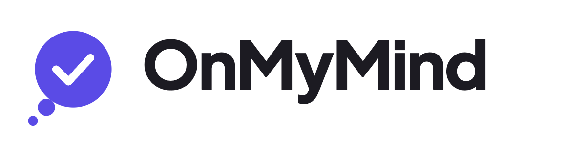
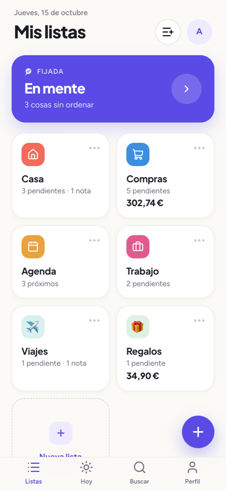
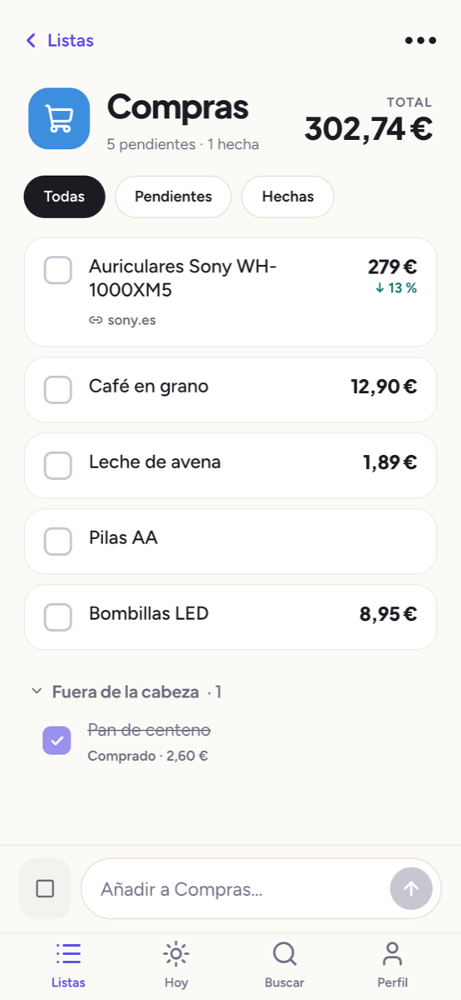
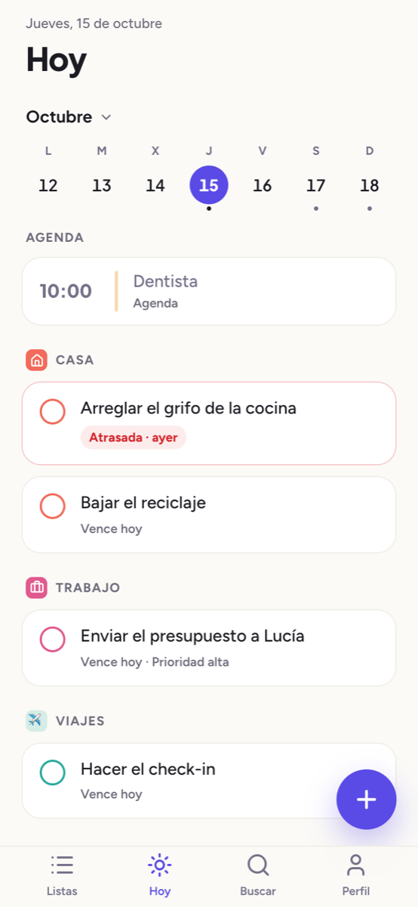
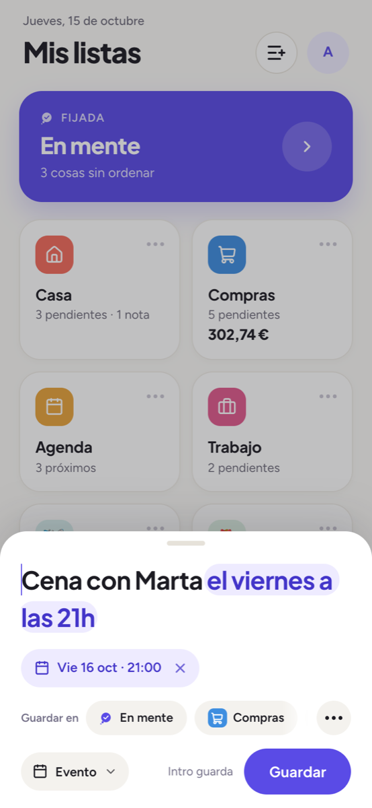
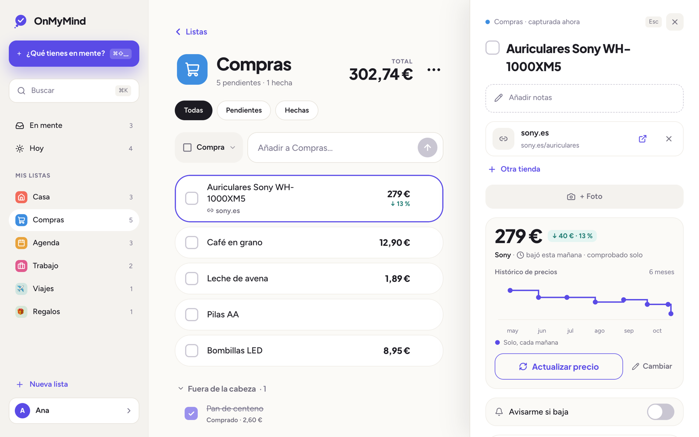

  <picture>
    <source media="(prefers-color-scheme: dark)" srcset="public/logos/png/onmymind-logo-dark.png" />
    
  </picture>

  <b>Sácalo de la cabeza.</b> 
  Listas para apuntar en segundos lo que tienes en mente (tareas, compras, eventos y notas) y
  encontrarlo después, cuando hace falta.

  <a href="README.md">English</a> · <b>Español</b>

  
  
  
  
  

  <picture>
    <source media="(prefers-color-scheme: dark)" srcset=".github/readme/movil-inicio-oscuro.png" />
    
  </picture>
  <picture>
    <source media="(prefers-color-scheme: dark)" srcset=".github/readme/movil-compras-oscuro.png" />
    
  </picture>
  <picture>
    <source media="(prefers-color-scheme: dark)" srcset=".github/readme/movil-hoy-oscuro.png" />
    
  </picture>
  <picture>
    <source media="(prefers-color-scheme: dark)" srcset=".github/readme/movil-captura-oscuro.png" />
    
  </picture>

  <picture>
    <source media="(prefers-color-scheme: dark)" srcset=".github/readme/escritorio-compras-oscuro.png" />
    
  </picture>

## Qué es

Casi todas las apps de tareas te obligan a decidir dónde va algo antes de poder apuntarlo.
OnMyMind lo hace al revés: primero lo sacas de la cabeza, en un par de segundos, y lo ordenas
después, si quieres. Es una web pensada para el móvil que se instala como una app, funciona sin
conexión y ha crecido desde una bandeja de entrada hasta listas donde conviven notas, tareas,
compras y eventos. La uso a diario.

## Qué hace

- ⚡ **Capturar en segundos.** El + en el móvil o ⌘⇧Espacio en el ordenador, y a «En mente».
  Entiende las fechas escritas («Cena con Marta el viernes a las 21h»), una lista pegada se
  convierte en una cosa por línea y se guarda lo que compartes desde cualquier app.
- 🗂️ **Listas con lo que haga falta.** Una lista no tiene tipo: dentro caben notas, tareas,
  compras y eventos, y sublistas. Cada una con su color y su icono o emoji. Para decidir entre
  varias opciones, una sublista «para elegir una» con su vista «Comparar».
- 🛒 **Compras con precio.** El precio sale de la web al pegar el enlace, con varias tiendas por
  compra y el total de la lista. Cada mañana se vuelve a mirar solo, se guarda su histórico y
  avisa si baja.
- 📅 **Hoy y la agenda.** Lo que vence hoy de todas las listas y los eventos del día, cualquier
  otro día con su calendario, repeticiones a medida, avisos y un resumen por la mañana. Los
  eventos también en el Calendario del iPhone o en Google Calendar.
- 👥 **Compartir en directo.** Una lista se comparte con un enlace, y lo que hace la otra
  persona llega al momento, con su inicial en lo que añade o termina.
- 🔒 **Lo privado.** Una clave privada que se abre con Face ID, la huella o Touch ID. Con ella,
  notas protegidas, cifradas en el aparato, para la clave del wifi o el código de la alarma, y
  listas ocultas que no se ven en ningún sitio hasta desbloquear.
- 📴 **Sin conexión.** Se instala como app, abre al momento con lo guardado y lo que cambias sin
  red se envía al volver, en orden.

## Lo técnico que destaca

- **Sin conexión de verdad.** La caché de TanStack Query se guarda en IndexedDB, y cada cambio
  que puede esperar pasa por una cola de mutaciones que sobrevive a cerrar la app y se repite en
  orden al volver la red. Cambios optimistas en todas partes, con vuelta atrás si fallan.
- **La seguridad, en la base y no en el cliente.** Row Level Security en todas las tablas: las
  reglas de compartir (quién ve una lista, quién puede cambiar la lista y quién solo lo de
  dentro) las impone PostgreSQL y las cubren tests de pgTAP. Una Content Security Policy
  estricta, sin scripts de terceros.
- **Cifrado en el aparato.** Las notas protegidas se cifran con AES-GCM antes de salir del
  aparato. La clave de la caja se envuelve con PBKDF2 (600.000 vueltas) a partir de la clave
  privada, y con la extensión PRF de WebAuthn para que Face ID la abra. La base solo ve texto
  cifrado; lo descifrado vive en memoria y se olvida al bloquear.
- **Tiempo real sin fugas.** Los cambios salen de la base hacia un canal privado por persona,
  solo con ids; cada cliente vuelve a pedir lo que puede ver, así que sigue decidiendo RLS.
- **Precios que se miran solos.** Una Edge Function programada (`pg_cron`) lee las páginas de
  producto por capas (JSON-LD, las meta de producto y de Open Graph, microdatos), guarda el
  histórico y avisa con Web Push (VAPID) cuando un precio baja.
- **Fechas y repeticiones.** Un analizador propio de fechas escritas en español, que prefiere no
  entender a entender mal, y repeticiones (RRULE) calculadas igual en TypeScript y en SQL,
  comprobadas contra los mismos casos.

## Cómo trabajo

- **El concepto, antes que el código.** Primero se escribe el producto: funcionalidades, modelo
  de datos, arquitectura y sistema de diseño. Después cada fase se planifica en sesiones
  pequeñas, cada una con su objetivo, los archivos que toca y una lista de verificación que hay
  que cumplir antes de cerrarla.
- **El diseño, antes que el código.** Cada pantalla se diseña antes, con un sistema de diseño
  cuyos tokens están ajustados para el contraste AA de WCAG. Lo que el diseño no cubre se decide
  de forma explícita y se deja por escrito, nunca se improvisa en el código.
- **Las decisiones, por escrito.** Las decisiones de arquitectura quedan en ADRs (13 hasta
  ahora): desde Supabase o Firebase y PWA o app nativa hasta el modelo de amenazas de lo
  privado.
- **Cambios pequeños y comprobados.** Una rama por tarea, que entra en `develop` con squash; `main`
  solo avanza por fast-forward. Un hook antes de cada push pasa el typecheck, `deno check` de las
  Edge Functions, el lint sin un solo aviso y todos los tests: nada en rojo sale.
- **Tests a todos los niveles.** Más de 1.140 tests de la app (Vitest y Testing Library, desde el
  punto de vista de quien la usa), más de 350 de la base (pgTAP) para RLS y las funciones SQL, y
  una pasada de punta a punta en un navegador de verdad, con la CSP, antes de cerrar cada
  sesión. Cada cambio en la base es una migración con sus tests.
- **Herramientas.** Además de las de siempre, uso asistentes de IA (Claude Code y Claude Design)
  para ir más rápido al implementar y al iterar el diseño, siempre dentro de los planes, las
  reglas y las comprobaciones de arriba.

### En números

| Fases | ADRs | Migraciones | Entregas de diseño | Tests de la app | Tests de la base |
| :---: | :--: | :---------: | :----------------: | :-------------: | :--------------: |
|   5   |  13  |     31      |         28         |      1.143      |       352        |

## Con qué está hecha

| Capa     | Tecnología                                                                    |
| -------- | ----------------------------------------------------------------------------- |
| Interfaz | React 19, TypeScript (estricto), Vite, TanStack Router y TanStack Query       |
| Diseño   | Tailwind CSS 4, shadcn/ui y Radix, iconos de lucide, Recharts, dnd-kit        |
| Servidor | Supabase: PostgreSQL con RLS, Auth, Storage, Realtime y Edge Functions (Deno) |
| App      | PWA con su propio service worker, caché en IndexedDB, Web Push, WebAuthn      |
| Calidad  | Vitest, Testing Library, pgTAP, ESLint (con tipos), Prettier, Husky           |
