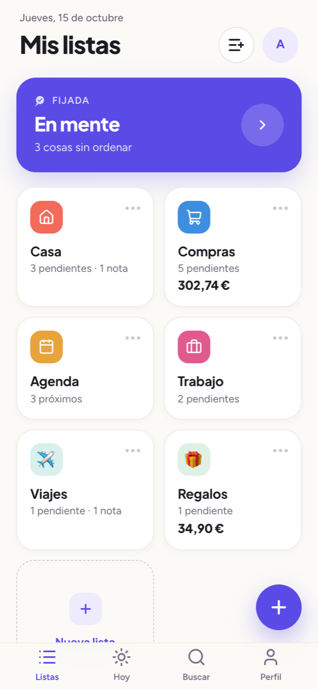
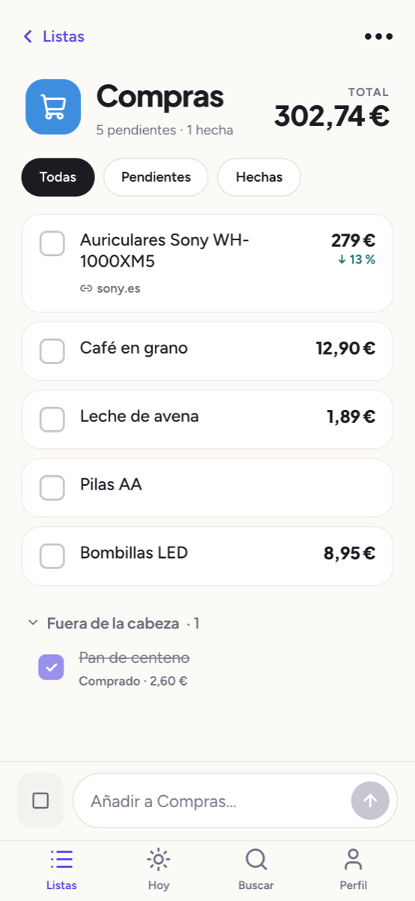
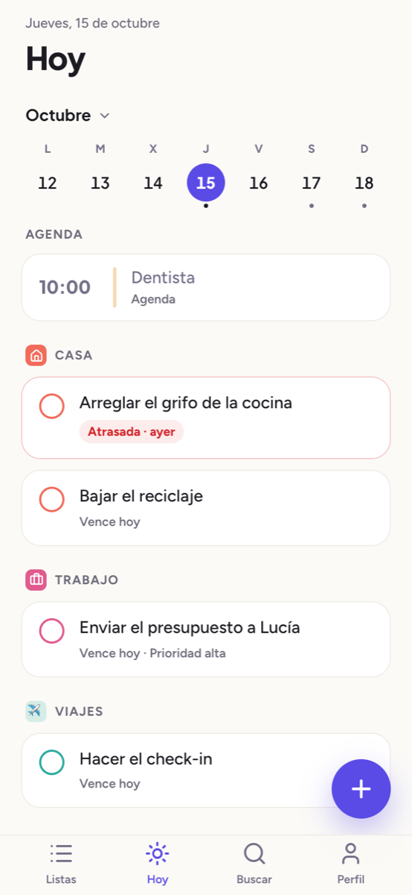
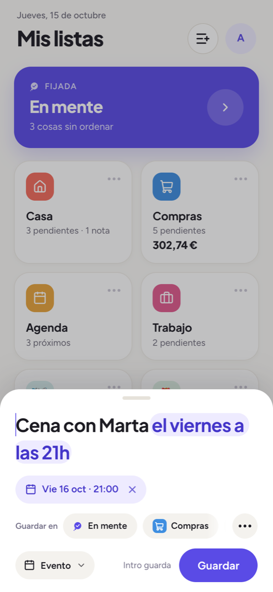
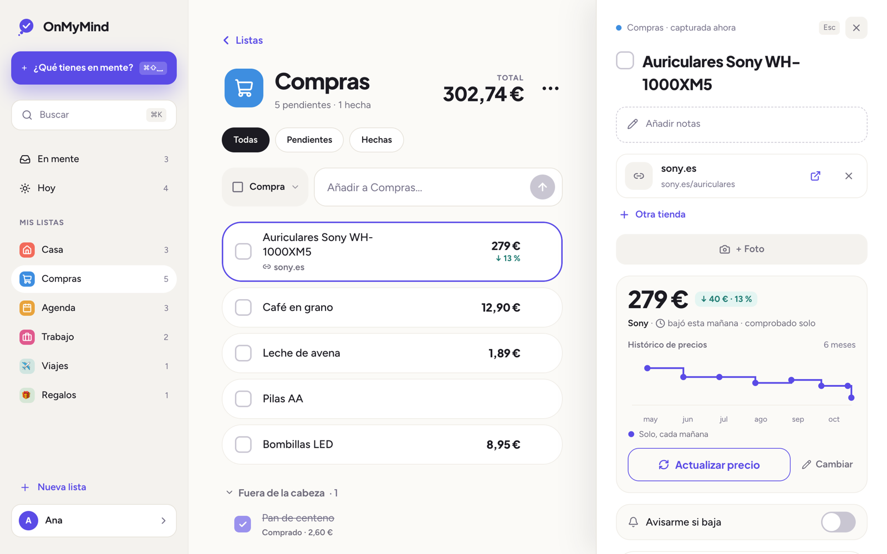

<p align="center">
  <picture>
    <source media="(prefers-color-scheme: dark)" srcset="public/logos/png/onmymind-logo-dark.png" />
    
  </picture>
</p>

<p align="center">
  <b>Sácalo de la cabeza.</b><br />
  Listas para apuntar en segundos lo que tienes en mente (tareas, compras, eventos y notas) y
  encontrarlo después, cuando hace falta.
</p>

<p align="center">
  <a href="https://onmymind.pages.dev"><b>onmymind.pages.dev</b></a>
</p>

<p align="center">
  
  
  
  
</p>

<p align="center">
  <picture>
    <source media="(prefers-color-scheme: dark)" srcset=".github/readme/movil-inicio-oscuro.png" />
    
  </picture>
  <picture>
    <source media="(prefers-color-scheme: dark)" srcset=".github/readme/movil-compras-oscuro.png" />
    
  </picture>
  <picture>
    <source media="(prefers-color-scheme: dark)" srcset=".github/readme/movil-hoy-oscuro.png" />
    
  </picture>
  <picture>
    <source media="(prefers-color-scheme: dark)" srcset=".github/readme/movil-captura-oscuro.png" />
    
  </picture>
</p>

<p align="center">
  <picture>
    <source media="(prefers-color-scheme: dark)" srcset=".github/readme/escritorio-compras-oscuro.png" />
    
  </picture>
</p>

## Qué hace

- ⚡ **Capturar en segundos.** El + en el móvil o ⌘⇧Espacio en el ordenador, y a «En mente».
  Entiende las fechas escritas («Cena con Marta el viernes a las 21h»), una lista pegada se
  convierte en una cosa por línea y se guarda lo que compartes desde cualquier app.
- 🗂️ **Listas con lo que haga falta.** Una lista no tiene tipo: dentro caben notas, tareas,
  compras y eventos, y sublistas. Cada una con su color y su icono o emoji. Para decidir entre
  varias opciones, una sublista «para elegir una» con su vista «Comparar».
- 🛒 **Compras con precio.** El precio sale de la web al pegar el enlace, con varias tiendas por
  compra y el total de la lista. Cada mañana se vuelve a mirar solo, se guarda su histórico y
  avisa si baja.
- 📅 **Hoy y la agenda.** Lo que vence hoy de todas las listas y los eventos del día, cualquier
  otro día con su calendario, repeticiones a medida, avisos y un resumen por la mañana. Los
  eventos también en el Calendario del iPhone o en Google Calendar.
- 👥 **Compartir en directo.** Una lista se comparte con un enlace, y lo que hace la otra
  persona llega al momento, con su inicial en lo que añade o termina.
- 🔒 **Lo privado.** Una clave privada que se abre con Face ID, la huella o Touch ID. Con ella,
  notas protegidas, cifradas en el aparato, para la clave del wifi o el código de la alarma, y
  listas ocultas que no se ven en ningún sitio hasta desbloquear.
- 📴 **Sin conexión.** Se instala como app, abre al momento con lo guardado y lo que cambias sin
  red se envía al volver, en orden.

## Cómo está hecha

React 19 y TypeScript estricto con Vite, Tailwind CSS 4 y shadcn/ui, TanStack Router y TanStack
Query. Detrás, Supabase: Postgres con RLS en todas las tablas, Auth, Storage, Realtime y Edge
Functions en Deno (los avisos push, el precio que se mira solo, el feed del Calendario). Es una
PWA con su propio service worker y la caché en IndexedDB, publicada en Cloudflare Pages. Se
prueba con Vitest y Testing Library, y la base con pgTAP.

Las convenciones de código y la estructura del proyecto están en [`CLAUDE.md`](CLAUDE.md).

<details>
<summary><b>Para desarrollar</b></summary>

### Requisitos

- Node 22 LTS (`nvm use` lee `.nvmrc`).
- pnpm, con la versión fijada en `package.json` (`corepack enable` la activa).
- Docker (o Colima), para levantar Supabase en local.
- Deno, solo para comprobar los tipos de las edge functions (`pnpm functions:check`).

### Arrancar en local

```bash
pnpm install
cp .env.example .env.local   # VITE_SUPABASE_URL y VITE_SUPABASE_ANON_KEY

pnpm db:start                # Supabase local; pnpm db:status enseña la URL y la anon key
pnpm dev                     # http://localhost:5173
```

### Comandos

| Comando                | Qué hace                                                          |
| ---------------------- | ----------------------------------------------------------------- |
| `pnpm build`           | Typecheck y build de producción, con el service worker            |
| `pnpm preview`         | Sirve el build, para probar la PWA                                |
| `pnpm typecheck`       | `tsc -b`                                                          |
| `pnpm lint`            | ESLint, con 0 avisos                                              |
| `pnpm format`          | Prettier (`pnpm format:check` solo comprueba)                     |
| `pnpm test`            | Los tests de la app (Vitest)                                      |
| `pnpm db:test`         | Los tests de la base (pgTAP) contra el Supabase local             |
| `pnpm functions:check` | `deno check` de las edge functions                                |
| `pnpm db:migration`    | Una migración nueva en `supabase/migrations/`                     |
| `pnpm supabase:types`  | Regenera `src/lib/supabase/database.types.ts` desde la base local |

Cualquier otro comando de la CLI de Supabase va con `pnpm exec supabase …`. El hook `pre-push`
pasa typecheck, `deno check`, lint y tests: un push con algo en rojo no sale.

### Despliegue

- **Producción:** <https://onmymind.pages.dev>, en Cloudflare Pages desde la rama `main`, que
  construye con `pnpm build` y publica `dist/`. `VITE_SUPABASE_URL` y `VITE_SUPABASE_ANON_KEY`
  están en el panel de Cloudflare y van dentro del build: cambiarlas pide otro despliegue.
- **La base:** las migraciones se suben con `pnpm exec supabase db push`. Una migración que ya
  está en la nube no se edita: los cambios van en una nueva.
- **Las edge functions:** `pnpm exec supabase functions deploy <nombre> --use-api`. Lo que necesita
  cada una está en [`supabase/functions/README.md`](supabase/functions/README.md).

</details>
